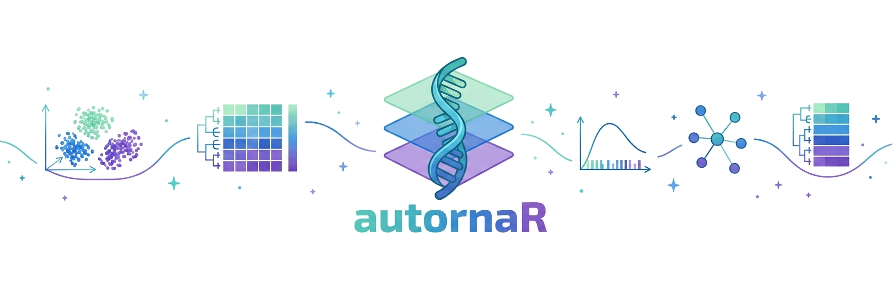
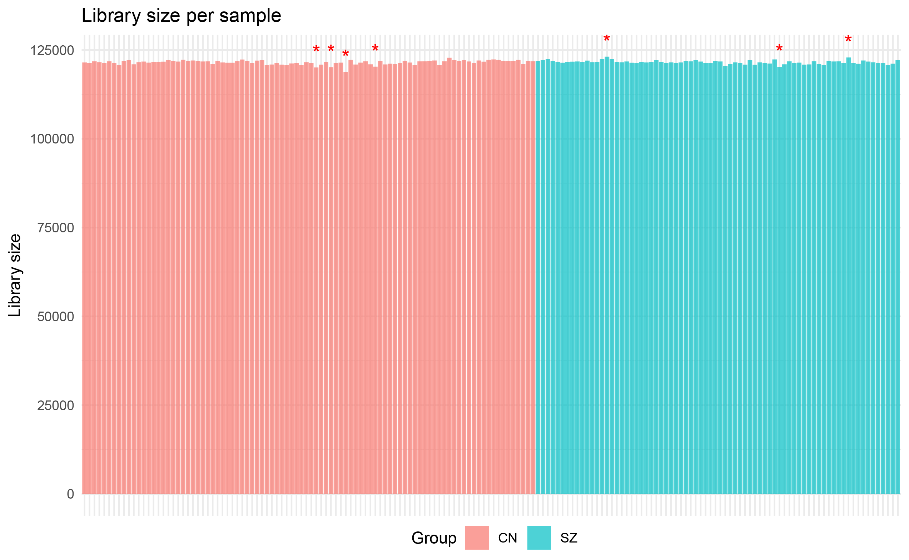
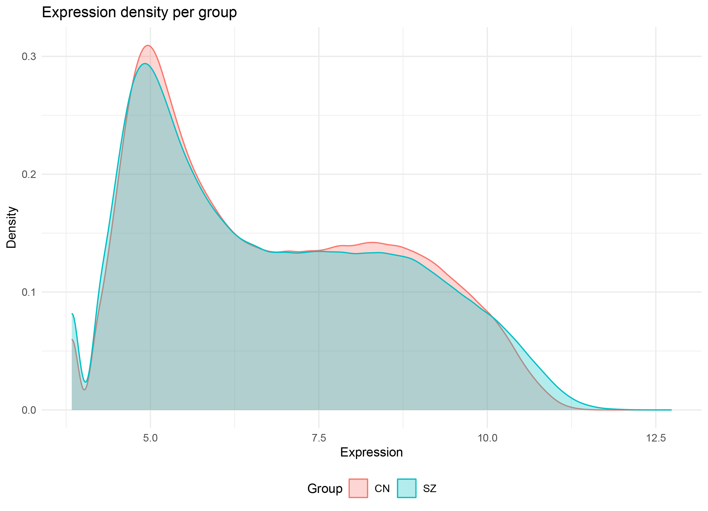
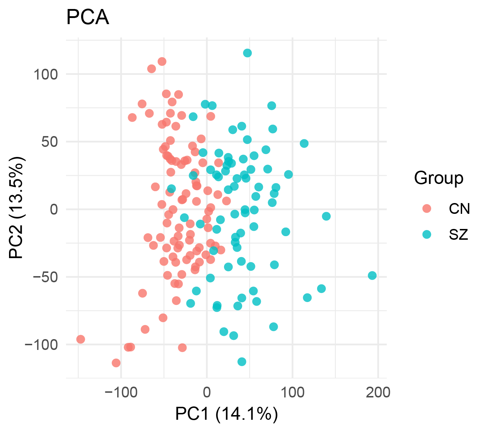
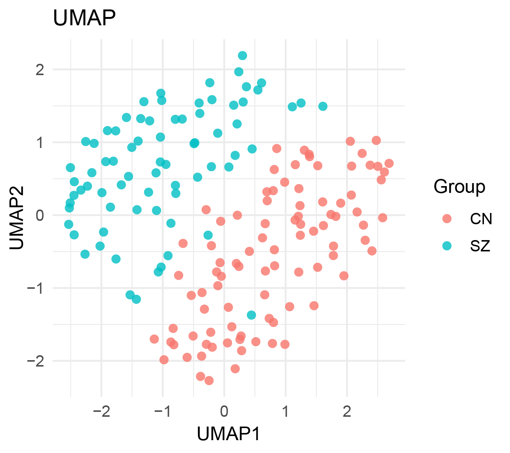
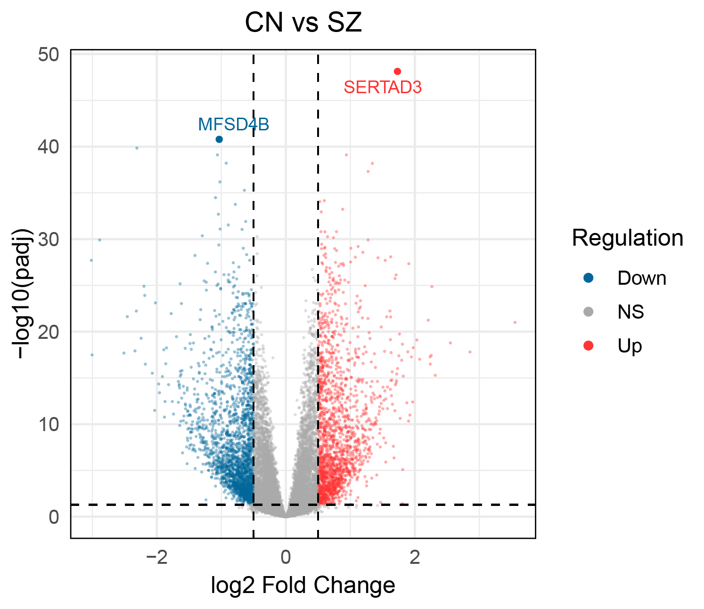
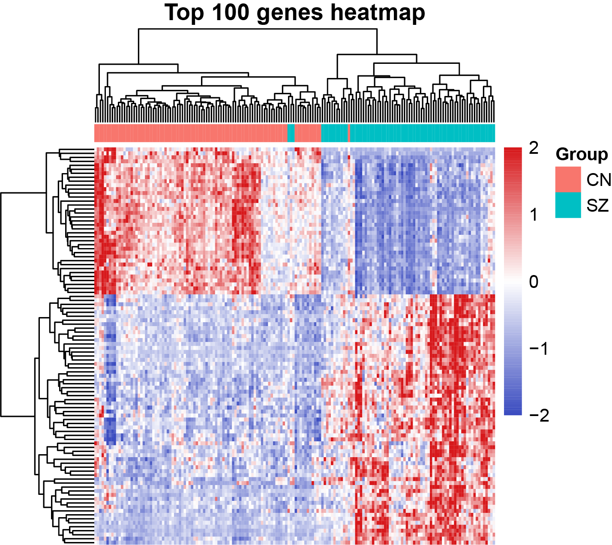
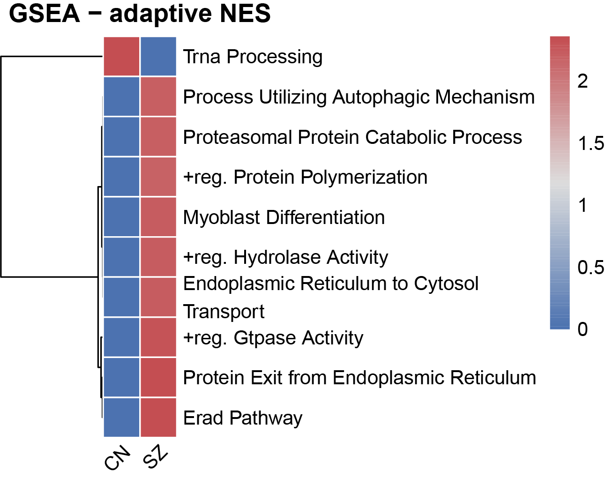
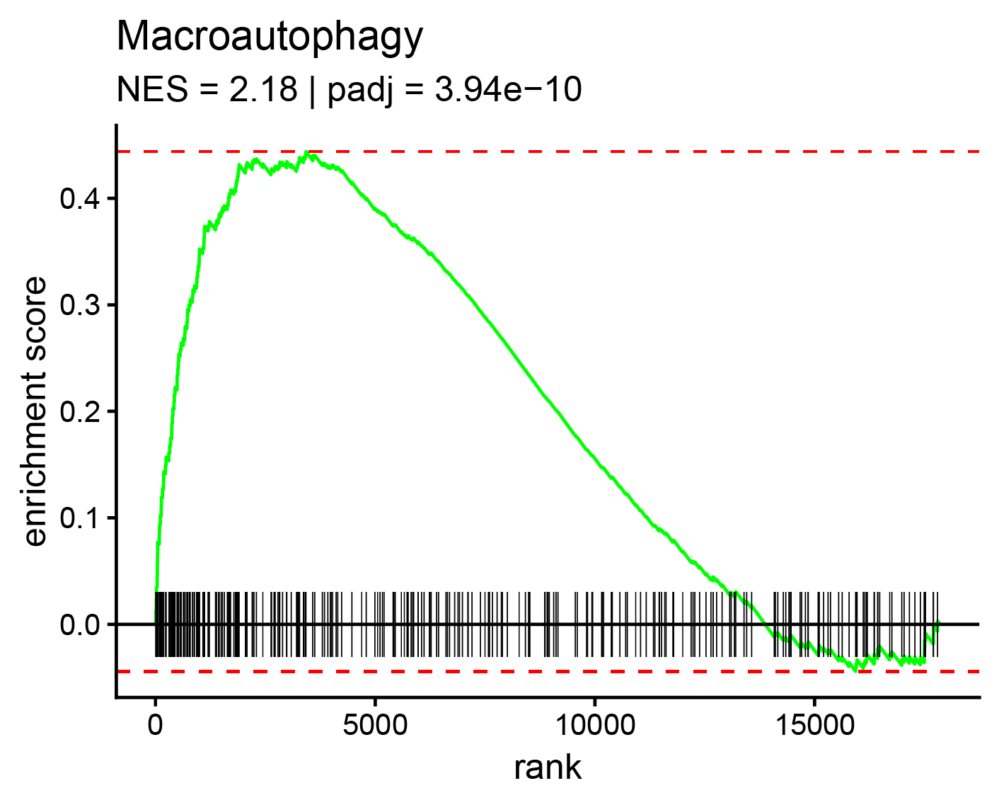
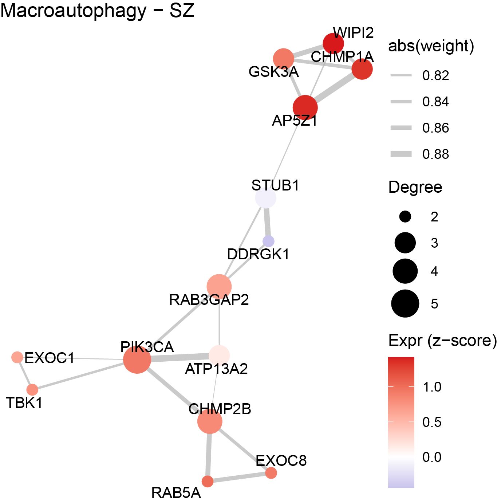

<br>

## Why autornaR?

The original idea behind `autornaR` emerged from a practical problem: I wanted to create a single, reusable script that would allow my colleagues to analyze publicly available bulk RNA-seq datasets from the Gene Expression Omnibus (GEO). However, each dataset seemed to come with its own structural peculiarities. Gene identifiers were not always stored as row names, samples were not always organized in columns, sample metadata sometimes lacked clear identifiers, and some datasets were distributed without metadata files.

These differences made it difficult to reuse the same analysis workflow across datasets. Instead of focusing on gene expression and its biological implications, we often had to spend considerable time reorganizing and standardizing the input data.

`autornaR` was developed to help address this problem by simplifying data preparation and reducing the effort required to get RNA-seq data ready for downstream analysis.

The package name follows the *auto* naming convention used in other tools that I am developing, such as `autometabR`, `autolearnR` and `autotestR`. The underlying idea is simple: automate routine tasks whenever possible, allowing users to spend more time on the analyses they actually want to perform.

## What does autornaR do?

`autornaR` provides a workflow for analyzing bulk RNA-seq count data associated with sample metadata. The metadata must identify each sample and its corresponding experimental group, but it can also include additional information of interest, such as clinical, laboratory, and demographic variables.

By bringing expression data and sample metadata together in a consistent structure, `autornaR` helps prepare the data for downstream analyses while preserving the information needed to investigate biological questions.

## Getting started

## 1. Installation

The development version of `autornaR` can be installed directly from GitHub:

```r
# Install remotes if needed
install.packages("remotes")

# Install autornaR
remotes::install_github("Luiz-Garcia-R/autornaR")
```

Once installed, you are ready to prepare your input data and run your first analysis.

## 2. Preparing the input data

RNA-seq datasets do not always come in the same format. Depending on the quantification or alignment workflow, gene identifiers may be stored in a column or in row names, sample names may contain file extensions, and additional columns may describe genomic coordinates or gene lengths rather than expression counts.

You do not need to manually standardize every dataset before using `autornaR`. The `rna_import()` function is designed to recognize common input structures and prepare them for downstream analysis. However, automatic detection is not a substitute for checking your data: the input format must be specified correctly, and the resulting count matrix and metadata should always be inspected.

### 2.1. Supported input formats

`rna_import()` currently supports five input formats:

| Format | Typical input |
|---|---|
| `"star"` | Gene-level counts generated by STAR, including its gene-count output |
| `"hisat2"` | Gene-level count tables associated with a HISAT2 workflow |
| `"featureCounts"` | Count tables generated by featureCounts |
| `"tximport"` | Gene-level count data prepared using tximport (Salmon or Kallisto) |
| `"clean"` | A previously organized table containing gene identifiers and sample counts |

These formats describe the structure of the input table, not necessarily the entire upstream analysis pipeline. For example, HISAT2 is an aligner, whereas featureCounts is a tool for assigning reads to genomic features.

The appropriate format depends on the file you are importing. If you have already prepared a table containing only gene identifiers and sample-level counts, use `"clean"`.

### 2.2. What does the import function handle?

During import, `rna_import()` can help with several common sources of inconsistency:

- **Gene identifiers:** detects identifiers stored in a column or, when appropriate, in row names.
- **Count columns:** identifies the columns intended to contain sample-level counts according to the selected input format.
- **Technical annotation columns:** excludes recognized genomic annotation fields, such as `Chr`, `Start`, `End`, `Strand`, and `Length`, when processing the supported alignment/count-table formats.
- **Gene identifiers:** detects common identifier types, including ENSEMBL, gene symbols, and ENTREZ IDs.
- **ENSEMBL identifiers:** removes version suffixes and sums counts for duplicated identifiers created by this cleaning step.
- **Sample names:** optionally removes file extensions and unsupported special characters or applies user-provided sample names.
- **Metadata:** detects the sample identifier column, checks its correspondence with the count matrix, and attempts to identify the group column.

The function also reports basic information about the imported data, including the number of genes and samples, detected identifier type, and potential data-integrity issues.

Importantly, `rna_import()` does not normalize or transform the counts. It prepares the input for subsequent analysis.

### 2.3. Preparing the metadata

The count matrix contains the expression measurements, whereas the metadata describes the samples. Keeping these two types of information separate makes it possible to associate each expression profile with the correct experimental group and any additional sample characteristics.

At a minimum, for group-based downstream analyses, your metadata should contain:

- **A sample identifier:** a column that identifies each sample and corresponds to the sample names in the count matrix.
- **A group variable:** a column indicating the experimental condition or group to which each sample belongs.

Additional variables, such as age, sex, clinical measurements, or treatment information, can also be included and may be useful in subsequent analyses.

For example:

```r
metadata <- data.frame(
  Sample = c("Sample_01", "Sample_02", "Sample_03", "Sample_04"),
  Group = c("Control", "Control", "Treatment", "Treatment"),
  Age = c(25, 31, 28, 34)
)
```

The sample identifiers must match the count matrix after any sample-name cleaning or renaming. Each sample should have a corresponding metadata record, and the group assignments must be correct.

The function attempts to detect sample and group columns automatically. You can also specify them explicitly using `gene_col` and `group_col` where appropriate. Check the import output and warnings to confirm that the intended columns were identified.

### 2.4. Importing your data

Once your count table and metadata are available, create an `rna_project` object and import the data:

```r
# Create a project
my_project <- rna_project()

# Import the count matrix and metadata
rna_import(
  project = my_project,
  count_matrix = counts_df,
  metadata = metadata,
  format = "star",
  organism = "human"
)
```

Replace `counts_df` with your own count table and select the appropriate input format. `autornaR` will automatically detect several input characteristics, including gene identifier type and, when possible, the organism. These automatic steps are designed to simplify data preparation, but they are not infallible. Always review the import summary and warnings to ensure that the detected information is consistent with your dataset.

For a previously cleaned table, you can use:

```r
rna_import(
  project = my_project,
  count_matrix = counts_df,
  metadata = metadata,
  format = "clean"
)
```

### 2.5. Check before moving on

After import, review the reported number of genes and samples, the detected identifier type, the sample names, the group sizes, and any warnings. In particular, confirm that the intended sample and group columns were detected and that the metadata corresponds to the expression data.

The goal is not to eliminate every possible inconsistency automatically. It is to reduce repetitive preparation work while making important assumptions and potential problems visible.

Once your data have been imported and checked, you can move on to your first `autornaR` workflow.

## 3. Your first autornaR workflow

In this section, we will use a publicly available RNA-seq dataset to demonstrate a workflow with `autornaR`, from importing count data to exploring gene expression and performing differential expression analysis.

The example uses dataset **GSE243841**, published by Pan et al. (2025), which investigated peripheral gene expression in patients with first-episode, drug-naïve schizophrenia and healthy controls. The dataset is available through the [Gene Expression Omnibus (GEO)](https://www.ncbi.nlm.nih.gov/geo/query/acc.cgi?acc=GSE243841), and the corresponding article can be accessed [here](https://doi.org/10.1016/j.pnpbp.2025.111302).

For this tutorial, we will use two files:

- `GSE243841_raw_counts_all.csv`: the count table downloaded from GEO.
- `metadata.csv`: a sample metadata table prepared separately to associate each sample with its experimental group.

The goal is to demonstrate the package workflow using a real dataset, rather than reproduce the published results.

### 3.1. Importing the dataset

First, load the count table and metadata into R. Make sure both files are available in your working directory or provide their full paths.

```r
# Load the count table and metadata
raw_data <- read.csv(
  "GSE243841_raw_counts_all.csv",
  check.names = FALSE
)

metadata <- read.csv(
  "metadata.csv",
  check.names = FALSE
)

# Create a project
proj <- rna_project()
```

Before importing the data, it is useful to inspect the structure of the metadata:

```r
str(metadata)
table(metadata$Group)
```

The metadata contains one row per sample, with a sample identifier and its corresponding experimental group. In this dataset, the two groups are healthy controls (`CN`) and patients with schizophrenia (`SZ`).

| Sample | Group |
|---|---|
| YD_001 | CN |
| YD_002 | CN |
| YD_003 | CN |
| YD_004 | CN |
| YD_005 | CN |
| YD_006 | CN |

The original metadata contains 181 samples distributed between the two groups:

| Group | Number of samples |
|---|---:|
| CN | 97 |
| SZ | 84 |
| **Total** | **181** |

The metadata is kept separate from the count table, allowing `autornaR` to associate each expression profile with the appropriate sample and group.

Next, import the count data:

```r
proj <- rna_import(
  project = proj,
  count_matrix = raw_data,
  metadata = metadata,
  format = "star",
  organism = "human",
  group_col = "Group"
)
```

Here, `format = "star"` is important because the original table is not a simple matrix of gene counts. It contains gene identifiers and technical annotation columns, including `CHR`, `START`, `END`, and `STRAND`. Some of these fields contain multiple genomic values separated by semicolons, reflecting the structure of the original output.

Rather than requiring the user to manually reorganize the table, `rna_import()` identifies the relevant count columns according to the selected format and prepares the data for subsequent analyses. It also handles gene identifiers, sample names, and metadata matching.

This illustrates one of the main purposes of `autornaR`: reducing repetitive data preparation while making the resulting structure easier to inspect. Automatic detection is not infallible, so the import summary and any warnings should always be reviewed.

### 3.2. Normalization and quality control

Once the data have been imported, we can prepare them for exploration and downstream analyses.

```r
# Normalize the data
proj <- rna_normalize(
  proj,
  method = "vst"
)

# Perform quality control
proj <- rna_qc(proj)
```

The `"vst"` method applies a variance-stabilizing transformation, which is useful for exploratory analyses of RNA-seq expression profiles. The normalization step can also filter low-expression genes and identify potential outliers, depending on the selected settings.

<table style="width:100%; border-collapse:collapse;">
  <tr>
    <td style="width:50%; text-align:center; vertical-align:top;">
      
      <p><strong>Library size</strong></p>
      <p style="font-size:0.9em;">
        Evaluation of library size across patients.
      </p>
    </td>
    <td style="width:50%; text-align:center; vertical-align:top;">
      
      <p><strong>Density plot</strong></p>
      <p style="font-size:0.9em;">
        Gene expression density across patients.
      </p>
    </td>
  </tr>
</table>

For this dataset, the current workflow retained 166 samples and 17,867 genes after filtering and outlier handling. These values describe the output of this particular run; they should not be interpreted as a definitive assessment of sample quality or as a reproduction of the filtering performed in the original publication.

The `rna_qc()` function provides a summary of several quality indicators, including library sizes, sample correlations, and within- and between-group correlations.

For example, the current QC report indicated:

| QC metric | Result |
|---|---:|
| Samples assessed | 166 |
| Genes assessed | 17,867 |
| Median library size | 121,629.7 |
| Library-size coefficient of variation | 0.46% |
| Mean sample correlation | 0.95 |
| Intra-group correlation | 0.955 |
| Inter-group correlation | 0.944 |

The report classified library-size quality as excellent, sample correlation as moderately consistent, and overall QC as acceptable. It also flagged samples for further investigation based on library size and sample correlation.

These summaries provide a useful first assessment, but they should not replace inspection of the underlying data. In particular, an automatically flagged sample is not necessarily an invalid sample, and group differences in correlation do not establish a biological mechanism.

The QC workflow also generates visual summaries, including expression-density distributions and library sizes across samples. These plots make it easier to inspect the distribution of expression values and identify samples whose library sizes differ substantially from the rest.

When a sample is flagged, the appropriate response is to investigate the available evidence and experimental context before deciding whether it should be excluded.

### 3.3. Exploring the expression data

After normalization and quality control, we can explore the overall structure of the dataset using dimensionality reduction.

```r
# Principal component analysis and UMAP
proj <- rna_dimred(proj)
```

The function performs principal component analysis (PCA) and can also generate a Uniform Manifold Approximation and Projection (UMAP) representation. These methods summarize high-dimensional expression data in a smaller number of dimensions, making major patterns of variation easier to visualize.

<table style="width:100%; border-collapse:collapse;">
  <tr>
    <td style="width:50%; text-align:center; vertical-align:top;">
      
      <p><strong>Principal component analysis (PCA)</strong></p>
      <p style="font-size:0.9em;">
        Samples projected onto the first two principal components.
      </p>
    </td>
    <td style="width:50%; text-align:center; vertical-align:top;">
      
      <p><strong>Uniform Manifold Approximation and Projection (UMAP)</strong></p>
      <p style="font-size:0.9em;">
        Low-dimensional representation of sample relationships.
      </p>
    </td>
  </tr>
</table>

In this run, the first two principal components explained 27.63% of the total variance:

| Principal component | Variance explained |
|---|---:|
| PC1 | 14.09% |
| PC2 | 13.53% |
| PC3 | 9.81% |
| PC4 | 5.71% |
| PC5 | 2.48% |

The PCA and UMAP plots provide complementary views of the data. PCA emphasizes directions of greatest overall variance, whereas UMAP is designed to represent local relationships between samples in a lower-dimensional space.

These visualizations can help identify sample clusters, investigate potential outliers, and assess whether experimental groups show patterns of separation. However, apparent separation is not proof of a biological mechanism, and overlap between groups does not rule out differential expression.

The results should be interpreted in the context of sample variability, the experimental design, and potential confounding factors.

### 3.4. Differential expression analysis

Once the data structure and quality have been reviewed, we can compare the experimental groups.

For this example, we compare patients with schizophrenia (`SZ`) against healthy controls (`CN`).

```r
# Differential expression analysis
proj <- rna_compare(
  proj,
  comparison = c("SZ", "CN"),
  method = "limma"
)

# Inspect the top differentially expressed genes
proj <- rna_degs(proj)
```

The `rna_compare()` function performs the selected pairwise comparison using `"limma"` or  `"deseq2"`, while `rna_degs()` allows us to inspect the resulting differentially expressed genes.

The order of the groups in `comparison` matters for interpreting the direction of the estimated effects. Consult the function documentation to confirm how the package reports effect sizes and defines the comparison direction.

Differential expression results should be interpreted using effect sizes, uncertainty, and appropriate multiple-testing correction, rather than statistical significance alone. The biological relevance of individual genes should also be evaluated in the context of the study.

Importantly, a transformed expression matrix used for exploratory visualization is not interchangeable with raw counts for every statistical test. The appropriate input depends on the differential expression method used by the package.

### 3.5. Where to go next

This workflow illustrates how `autornaR` can help move from a heterogeneous count table to an organized project, quality assessment, exploratory visualization, and differential expression analysis.

The package also provides functions for visualizing differential expression results, investigating enriched biological pathways, examining gene-level associations, and exploring expression patterns. These additional analyses are introduced in the next section.

## 4. Exploring differential expression results

Once differential expression analysis has been performed, `autornaR` provides several functions to explore the results from different perspectives. These include visualizing individual genes, examining expression patterns across samples, identifying enriched biological pathways, and investigating gene coexpression networks.

The following examples use the comparison between patients with schizophrenia (`SZ`) and healthy controls (`CN`) created in the previous section. Each function builds on the existing project, allowing results to be stored and reused throughout the workflow.

### 4.1. Visualizing differential expression

A volcano plot provides an overview of the relationship between gene expression changes and statistical significance. It helps identify genes with large estimated effects and strong statistical evidence for differential expression.

```r
# Generate a volcano plot and highlight selected genes
proj <- rna_volcano(
  proj,
  genes = c("SERTAD3", "MFSD4B")
)
```

By default, `rna_volcano()` uses the most recent differential expression comparison stored in the project. The `genes` argument allows specific genes of interest to be labeled directly on the plot, making it easier to connect the overall distribution with particular findings.

<table style="width:100%; border-collapse:collapse;">
  <tr>
    <td style="text-align:center; vertical-align:top;">
      
      <p style="width:50%; margin:8px auto; font-size:0.9em;">
        Plot of the SZ vs CN comparison, highlighting SERTAD3 and MFSD4B.
      </p>
    </td>
  </tr>
</table>

The plot highlights significantly upregulated and downregulated genes according to the selected adjusted p-value and log2 fold-change thresholds. These thresholds help organize the results, but statistical significance and effect size should be considered together when prioritizing genes for further investigation.

### 4.2. Exploring gene expression patterns

While a volcano plot summarizes differential expression one gene at a time, a heatmap reveals how expression patterns vary across multiple genes and samples.

```r
# Generate a heatmap using the most recent comparison
proj <- rna_heatmap(proj)
```

By default, `rna_heatmap()` selects the top 100 genes based on the stored comparison, applies row-wise z-score scaling, and clusters genes and samples. The standardized values emphasize relative expression patterns across samples rather than absolute expression levels.

<table style="width:100%; border-collapse:collapse;">
  <tr>
    <td style="text-align:center; vertical-align:top;">
      
      <p style="width:50%; margin:8px auto; font-size:0.9em;">
        Heatmap of top 100 most variable genes across samples,
        with hierarchical clustering and group annotations.
      </p>
    </td>
  </tr>
</table>

The heatmap can reveal groups of genes with similar expression patterns, variation between individuals, and potential sample clusters. It complements the volcano plot by showing how expression profiles are organized across the dataset.

Gene selection, clustering, and scaling can be customized. For example, users can provide a specific gene set or select the most variable genes instead of relying on the default comparison-based selection.

### 4.3. Interpreting differential expression through pathway enrichment

Differential expression results can also be examined at the pathway level. Gene Set Enrichment Analysis (GSEA) evaluates whether genes belonging to predefined biological pathways tend to accumulate toward one end of a ranked gene list.

```r
# Perform gene set enrichment analysis
proj <- rna_gsea(proj)
```

The function uses the stored differential expression results to rank genes and evaluate enrichment across gene sets. It also provides visual summaries of enriched pathways, including enrichment plots and a heatmap of normalized enrichment scores (NES), depending on the selected settings.

<table style="width:100%; border-collapse:collapse;">
  <tr>
    <td style="width:50%; text-align:center; vertical-align:top;">
      
      <p><strong>GSEA heatmap</strong></p>
      <p style="font-size:0.9em;">
        GSEA summary showing top enriched signatures and their normalized enrichment scores.
      </p>
    </td>
    <td style="width:50%; text-align:center; vertical-align:top;">
      
      <p><strong>Enrichment plot</strong></p>
      <p style="font-size:0.9em;">
        Enrichment profile of the 'macroautophagy' gene set along the ranked list of genes.
      </p>
    </td>
  </tr>
</table>

Unlike an analysis restricted to a predefined list of significant genes, GSEA considers the ranked gene list as a whole. This can help identify coordinated biological signals that may not be apparent when interpreting individual genes separately.

The normalized enrichment score indicates the direction and relative strength of enrichment. Its biological interpretation depends on the direction of the underlying comparison and the gene-ranking convention used by the function. Enriched pathways should therefore be treated as hypotheses for further investigation rather than direct evidence that a biological process is activated or inhibited.

### 4.4. Exploring pathway coexpression networks

Pathway enrichment provides a functional overview, but it does not describe how genes within a pathway covary across samples. The `rna_network()` function provides a complementary view by constructing a correlation-based gene coexpression network for a selected pathway and experimental group.

This analysis requires GSEA results to be available in the project. For example, we can investigate the *Macroautophagy* pathway in the schizophrenia group:

```r
# Build a pathway coexpression network
proj <- rna_network(
  proj,
  pathway = "Macroautophagy",
  group = "SZ",
  node_filter = "top",
  top_nodes = 0.05
)
```

Here, `pathway` identifies the gene set of interest, while `group` specifies the samples used to calculate gene–gene correlations. The `node_filter = "top"` option restricts the displayed network to a subset of central genes, producing a more focused view of the pathway.

<table style="width:100%; border-collapse:collapse;">
  <tr>
    <td style="text-align:center; vertical-align:top;">
      
      <p style="width:50%; margin:8px auto; font-size:0.9em;">
        Coexpression network for the Macroautophagy pathway in the SZ group, highlihting central genes.
      </p>
    </td>
  </tr>
</table>

In the resulting network, nodes represent genes and edges represent gene–gene associations that meet the selected correlation criteria. Network topology can help identify highly connected genes, potential bridging nodes, and groups of genes with related expression patterns.

The network is exploratory: centrality measures identify genes that occupy prominent positions in the estimated network, but they do not establish causal regulation or prove that a gene controls the pathway. The resulting structure also depends on the selected samples, correlation threshold, and node-filtering strategy.

### 4.5. Further analyses

The functions demonstrated here represent only a subset of the analyses available in `autornaR`. Additional tools support gene-level visualization, alternative gene-set analyses, pathway activity profiling, network exploration, and other downstream workflows.

Together, these functions allow users to move from differential expression results toward broader biological interpretation while retaining a consistent project structure. The appropriate next step depends on the research question, the experimental design, and the evidence provided by each analysis.

